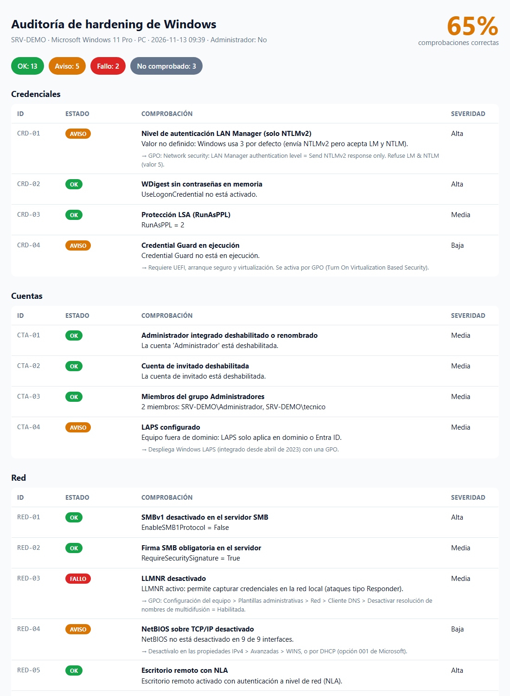

# windows-hardening-audit

[](https://github.com/samuelmartindelgado/windows-hardening-audit/actions/workflows/ci.yml)


Auditoría de seguridad para **Windows Server y Windows 10/11** en un solo comando. Revisa 23 puntos de configuración
que suelen quedarse mal (SMBv1, LLMNR, NTLM, RDP sin NLA, WDigest, LAPS, BitLocker, parches...) y genera un informe HTML
con semáforo y la recomendación concreta para arreglar cada uno.

**Es de solo lectura.** No cambia nada en el equipo: se puede pasar en producción sin riesgo. Hay una prueba automática
que falla si alguien añade un comando que modifique la configuración.



## Uso

```powershell
# Sin administrador ya funciona; como administrador comprueba también BitLocker, Secure Boot y PowerShell 2.0
.\Invoke-HardeningAudit.ps1

# Solo HTML, en otra carpeta
.\Invoke-HardeningAudit.ps1 -OutputPath C:\Informes -Format Html

# Para un pipeline: termina con código 1 si hay algún fallo de severidad alta
.\Invoke-HardeningAudit.ps1 -FailOnFallo -Quiet
```

Genera `hardening_<EQUIPO>_<fecha>.html` (para leer) y `.json` (para comparar entre equipos o importar en otra herramienta).

## Qué revisa

| Id | Comprobación | Severidad |
|---|---|---|
| RED-01 | SMBv1 desactivado | Alta |
| RED-02 | Firma SMB obligatoria (fallo en servidores, aviso en PC) | Media |
| RED-03 | LLMNR desactivado (ataques tipo Responder) | Media |
| RED-04 | NetBIOS sobre TCP/IP desactivado | Baja |
| RED-05 | Escritorio remoto solo con NLA | Alta |
| RED-06 | Cortafuegos activo en los tres perfiles | Alta |
| CTA-01 | Administrador integrado deshabilitado o renombrado | Media |
| CTA-02 | Cuenta de invitado deshabilitada | Media |
| CTA-03 | Quién está en el grupo Administradores | Media |
| CTA-04 | LAPS configurado | Media |
| CRD-01 | Nivel de autenticación LAN Manager (solo NTLMv2) | Alta |
| CRD-02 | WDigest sin contraseñas en memoria | Alta |
| CRD-03 | Protección LSA (RunAsPPL) | Media |
| CRD-04 | Credential Guard en ejecución | Baja |
| SIS-01 | UAC activado | Alta |
| SIS-02 | Antivirus en tiempo real con firmas al día | Alta |
| SIS-03 | BitLocker en la unidad del sistema * | Media |
| SIS-04 | Último parche instalado hace menos de 45 días | Alta |
| SIS-05 | Sin reinicio pendiente | Baja |
| SIS-06 | PowerShell 2.0 desinstalado * | Media |
| SIS-07 | Arranque seguro (Secure Boot) * | Media |
| SIS-08 | Reproducción automática desactivada | Baja |
| SIS-09 | Cola de impresión parada en servidores (PrintNightmare) | Media |

\* Necesitan administrador. Sin él aparecen como *No comprobado* en lugar de dar un error.

Cada resultado lleva su referencia (CIS Benchmark o documentación de Microsoft).

## Cómo está hecho

- **PowerShell 5.1 y 7**, sin módulos externos: funciona en un servidor recién instalado.
- Cada comprobación es una función `Test-*` en `checks/`. Añadir una nueva es crear una función que devuelva `New-Resultado`.
- Ninguna comprobación puede tumbar la auditoría: cada una captura sus errores y devuelve *No comprobado* con el motivo.
- El informe HTML es un único fichero sin JavaScript ni recursos externos, y todo el texto va codificado.

## Pruebas

En cada cambio, GitHub Actions ejecuta en una máquina Windows limpia:

1. **PSScriptAnalyzer**, el análisis estático de PowerShell.
2. **Pester 5**: estructura de las 23 comprobaciones, lógica con el registro simulado (WDigest, UAC, RDP, NTLM, LLMNR),
   codificación del HTML y la prueba de que el código es de solo lectura.
3. **La auditoría real** en PowerShell 7 y en Windows PowerShell 5.1. Los informes quedan como artefacto descargable.

```powershell
Invoke-Pester ./tests
```

## Licencia

MIT
